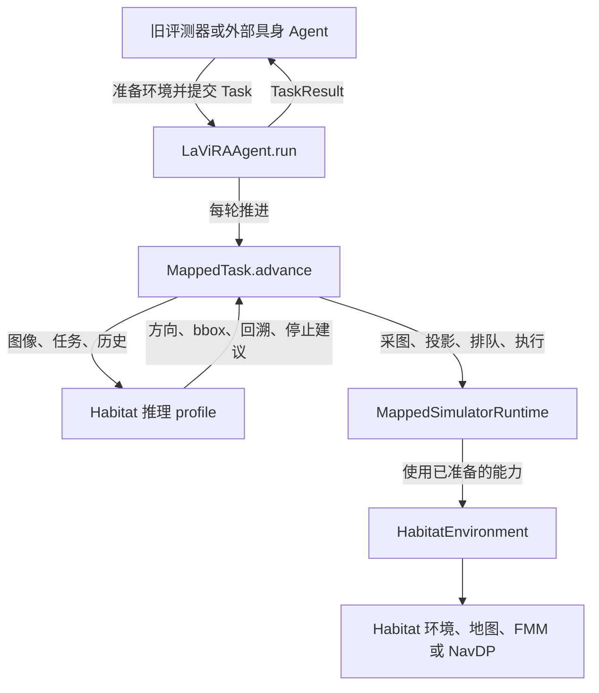

# 06 · 沿 Habitat 的一次导航读懂算法、地图执行与环境边界

假设任务是“走出卧室，在走廊右转，到餐桌旁停下”。LaViRA 需要判断进度、选择方向和目标，Habitat 则需要采图、把图上目标投影到地图、规划下一步并推进仿真。本页沿这条路径阅读代码，重点看每次交接传递什么，以及状态由谁保存。

这里的 Habitat 路径包含地图、离散动作和历史航点回溯，流程比地面机器人的一次 `navigate()` 更细。共享的是完整任务入口和算法归属；当前保留 `MappedTask` 实现 Habitat 的策略差异，不能把它描述成四个平台都使用完全相同的一组运行时方法。

## 1. 先找到现在真正运行的入口

从 [旧评测器 `rollout`](../../sim-code/habitat/vlnce_baselines/ZS_Evaluator_mp.py#L57) 开始。过去集中在评测器内的导航循环已迁入共享包；这里仍保留数据集与 episode 的准备工作，然后装配算法和执行能力：

```python
runtime = MappedSimulatorRuntime(
    self, obs, full_pose, tensor_api=torch, actions=HabitatSimActions,
    project_pixel=get_world_xz_from_pixel, displacement=calculate_displacement,
    collision_check=collision_check_fmm, log=logger)
core = LaViRAAgent(
    self.agent, "habitat", use_continuous_history=self.use_continuous_history,
    history_interval=self.history_interval, target_reached_cells=self.target_reached_threshold)
```

这是 [当前源码中的装配片段](../../sim-code/habitat/vlnce_baselines/ZS_Evaluator_mp.py#L90)。`self` 此时既是兼容评测入口，也是继承了 `HabitatEnvironment` 的环境能力对象；`self.agent` 才是 LaViRA 的推理对象。

紧接着，评测器把任务类型、文字、episode ID 和步数预算封装成 `Task`，调用 `core.run(...)`。返回后再复制导航记录、汇总计数，并把 `result.answer` 交给评测逻辑。**评测器保留装配和评测，完整导航任务交给共享核心。**



图中的箭头是实际调用关系。模型不会直接调用 `envs.step()`，运行时也不读取 LA/VA 的回复来决定任务是否完成。

## 2. 环境是谁创建、重置和关闭的

[旧评测器的 `eval`](../../sim-code/habitat/vlnce_baselines/ZS_Evaluator_mp.py#L134) 初始化环境、参考轨迹和局部策略，逐个调用 `rollout()`，最后关闭 `envs`。单次 rollout 中的 [`_maps_initialization`](../../sim-code/habitat/vlnce_baselines/habitat_environment.py#L577) 才真正执行 `envs.reset()`，提取指令并建立初始地图和位姿。

对新接入系统来说，这些步骤由外部系统负责。`HabitatEnvironment` 允许直接使用，无须先创建 LaViRA 客户端；具体初始化示例在 [使用文档](../lavira-usage.md#habitat-任务与地图执行)。

需要区分三个不同的“重置”：

| 操作 | 谁调用 | 实际清理或准备的内容 |
| --- | --- | --- |
| `host._maps_initialization()` | 外部装配或旧 rollout | reset 仿真 episode，读取初始观测，初始化地图和位姿 |
| `host.reset()` | 外部 episode 管理者或旧评测循环 | 清理地图派生状态，reset 局部策略和建图模块，清除地形提示 |
| `core.run()` 内的 `reasoning.reset()` | LaViRA 核心 | 重置推理中的 TODO、楼梯提示和末端目标，并创建新的任务状态 |

对照 [host 的 reset](../../sim-code/habitat/vlnce_baselines/habitat_environment.py#L616) 和 [核心的 Habitat 初始化分支](../../lavira/agent.py#L49)：算法不会替调用者关闭环境；host 的 reset 也不会替算法清理记忆。`host.reset()` 不等于再次执行 `envs.reset()`，两者在当前旧流程中分别发生。

## 3. 谁保存哪些状态

阅读大文件时先问“这段代码写的是哪一种状态”，比记住每个变量名更有用。

| 所在位置 | 状态举例 | 为什么放在这里 |
| --- | --- | --- |
| `TaskState` 与 `MappedTask` | 历史航点、连续图像、目标地图位置、是否回溯、待确认停止、停止被拒次数 | 它们决定 LaViRA 下一步如何推理和结束任务 |
| `lavira.reasoning.habitat.VLMReasoningAgent` | TODO、末端目标、楼梯识别结果、模型输入与解析逻辑 | 它们属于 LaViRA 的策略和模型交互 |
| `MappedSimulatorRuntime` | 当前观测/位姿、动作队列、仿真步数、done/infos、地图参考系 | 它们描述当前执行进展，使算法能按步使用环境 |
| `HabitatEnvironment` | 仿真实例、建图模块、可通行地图、碰撞图、局部控制器、NavDP 轨迹缓存、可视化与评测 | 它们是被算法调用的环境和执行能力 |

源码入口分别是 [MappedTask 初始化](../../lavira/reasoning/mapped_task.py#L10)、[推理对象初始化](../../lavira/reasoning/habitat.py#L25)、[运行时初始化](../../navigation_runtime/mapped_simulator.py#L16) 和 [host 初始化](../../sim-code/habitat/vlnce_baselines/habitat_environment.py#L64)。

执行层虽然仍有 `LaViRAVisualizer` 这样的历史命名，也会收到航点、TODO 和模型输出的记录信息，但这些用于记录展示。决定往哪走的逻辑已经在算法层；空的记录信息不要求接入另一种算法时伪造 LaViRA 模型回复。

## 4. 第一轮：采全景，让 LA 判断该往哪里走

[`LaViRAAgent.run`](../../lavira/agent.py#L67) 负责持续检查运行状态、取消请求和预算，Habitat 分支每轮调用一次 [`MappedTask.advance`](../../lavira/reasoning/mapped_task.py#L53)。后者先让运行时准备当前观测和记录信息，再决定是否需要新的模型推理。

假设还没有目标，`MappedTask` 调用 `observe_panorama()`。Habitat 的全景是一次有执行副作用的采集：[`_scan`](../../navigation_runtime/mapped_simulator.py#L784) 连续执行 12 次左转，每次 30°，取回一圈中的 0°、90°、180°、270° 四张图。每次转动还会调用建图模块。

[`observe_panorama`](../../navigation_runtime/mapped_simulator.py#L96) 把这些图封装成 `Panorama.views`，名称为 `forward/left/behind/right`。图像附有深度、相机内参、基准位姿、朝向偏移和地图参考系，供后面的历史回溯投影使用。

这解释了两个容易读错的计数：`state.cycles` 在发起一次方向决策时增加，`runtime.step` 则计入仿真动作。全景一次计 12 步，即使采集中途 episode 已结束也沿用旧计数；预算在外层下一轮检查，因此不是每次转动前都严格检查剩余步数。

算法随后保存一个航点，里面有起始图、全景、地图位置和位姿，再调用 [`navigate_or_backtrack`](../../lavira/reasoning/habitat.py#L217)。LA 收到指令、历史和当前图像，给出继续导航、回溯或停止意图，连同方向、TODO 更新和进度分析。

如果 LA 选择左转，算法调用 `runtime.turn(90)`；运行时只是排入三个左转动作。接下来各轮通过 `execute_pending()` 消耗动作队列，队列未完成时不会又启动一轮新的 LA/VA 目标选择。见 [方向选择到转动的交接](../../lavira/reasoning/mapped_task.py#L249) 和 [运行时转动队列](../../navigation_runtime/mapped_simulator.py#L115)。

## 5. 第二轮：VA 的像素目标怎样变成地图目标

转向完成后，[MappedTask 调用 VA](../../lavira/reasoning/mapped_task.py#L273)，提供当前 RGB、深度、宽高、LA 的进度分析及计划动作。共享推理中的 [`query_llm`](../../lavira/reasoning/habitat.py#L840) 组织模型请求并解析 bbox，返回的框仍是图像上的目标，不是机器人动作。

算法在 [`_project`](../../lavira/reasoning/mapped_task.py#L46) 选择框上的像素点：通常取底边中点；楼梯提示为真时沿用旧逻辑取顶边中点。然后把 `PixelGoal(view, u, v)` 交给运行时做空间转换。

[`MappedSimulatorRuntime.project`](../../navigation_runtime/mapped_simulator.py#L124) 依次执行：检查图像属于本 episode 的地图且深度格式正确；预处理深度；按采集位姿和全景朝向修正相机朝向；投影到地图平面的米坐标；再换成地图格并限制在地图边界内。

这里三个坐标不要混用：

| 数据 | 单位与参考系 | 代码中的表达 |
| --- | --- | --- |
| `Frame.pose` | 地图平面 x/y 为米，heading 为度 | `current_pose`，全景另带 `pose_heading_offset` |
| `PixelGoal` | 当前或历史图像的像素 u/v | 与该 `Frame` 绑定 |
| `MapGoal` 和 `runtime.position` | 地图格 x/y，携带米/格比例 | `metres_per_cell = host.resolution / 100.0`，`reference_frame = "episode_map:" + episode_id` |

例如地图分辨率为 5 cm/格时，20 格对应 1 m。航点字典里的旧字段虽叫 `world_coords`，在这条调用链中保存的其实是地图格坐标，不能仅凭字段名当成世界坐标的米数。对照 [position 与 map_goal](../../navigation_runtime/mapped_simulator.py#L57) 和 [航点保存](../../lavira/reasoning/mapped_task.py#L152)。

Habitat 的原始深度标为 `normalized_0_1`，不是米。投影路径沿用 `_preprocess_depth(..., 0.1, 5.0) / 100.0`；NavDP 输入路径则用传感器配置的最小/最大深度换算米值。两条旧换算路径并未在本次重构中强行合并。

`adjust_depth=True` 时，如果投影点不可通行，运行时会按旧逻辑逐次减去 0.1 m 深度后重新投影，直到找到可通行点或深度足够小。这个“怎么把像素变成可执行地图点”的处理在执行侧；选哪个 bbox、何时换目标仍在算法侧。

## 6. 执行地图目标：FMM、NavDP 和楼梯提示

算法拿到地图目标后调用 `queue_navigation(goal, initial=True)`，后续轮次继续对同一目标调用 `queue_navigation(goal)`。运行时检查目标的参考系和地图尺度，再通过局部控制器生成一个离散动作。见 [目标排队](../../navigation_runtime/mapped_simulator.py#L153) 与 [局部规划入口](../../navigation_runtime/mapped_simulator.py#L194)。

当前 host 真正支持的装配路径是 FMM 和 NavDP：[`initialize_controllers`](../../sim-code/habitat/vlnce_baselines/habitat_environment.py#L122) 把 `use_iplanner` 固定为 `False`。运行时仍保留旧 iPlanner 分支，但不能据此宣称当前 Habitat 入口可启用它。

| 配置/状态 | 使用哪条规划路径 |
| --- | --- |
| FMM 开启，未启用 NavDP | FMM |
| FMM 关闭，NavDP 开启 | NavDP |
| FMM 与 NavDP 都开启，没有楼梯提示 | FMM |
| FMM 与 NavDP 都开启，楼梯提示为真 | NavDP |

楼梯语义由 [LA 回复解析](../../lavira/reasoning/habitat.py#L603) 得到，再由 MappedTask 写到 `runtime.terrain_hint`；运行时根据提示与外部控制器配置选择执行路径。提示不是另一个任务管理器，也不让执行层访问推理对象。

NavDP 的后续规划保留“间隔至少 5 步或缓存为空时重新规划”的逻辑，`last_navdp_step`、局部轨迹与全局轨迹都保存在 host。当前位姿用于把缓存的全局轨迹换回机体坐标，挑选前方追踪点。见 [NavDP 缓存与更新](../../navigation_runtime/mapped_simulator.py#L650)。它们属于局部执行状态，不是 LaViRA 的航点记忆。

最终 [`execute_pending`](../../navigation_runtime/mapped_simulator.py#L160) 才实际调用 `envs.step()`，增加步数，更新观测、地图和碰撞信息。`ExecutionReport(execution_called=True)` 说明已经调用仿真动作；它没有自动证明到达目标。算法在 [下一轮目标检查](../../lavira/reasoning/mapped_task.py#L69) 中根据地图距离判断到达，并保留先检查 15 步目标超时、再检查到达的顺序。

## 7. 回溯为何需要历史图像和采集位姿

假设走到走廊后 LA 发现之前选错了门，它可以返回 `BACKTRACK` 和航点编号。这里不是简单地“向后走”，而是根据历史航点决定重新规划或先返回。两个分支见 [回溯决策处理](../../lavira/reasoning/mapped_task.py#L178)。

`backtrack_second_chance=True` 时，算法把目标航点之前的经历和失败路径交给 `replan_at_backtrack()`，让 LA 选择那个历史位置的新方向；VA 再看该方向的历史图像并给出 bbox。投影使用历史 RGB、深度、内参、基准位姿与朝向偏移，生成现在要去的地图目标。历史位姿缺失时，调用者明确给出原航点地图位置作为 fallback。

关闭该选项时，算法直接把历史航点地图位置作为目标，标记 `backtracking_only`；返回到那里或目标超时后，再回到正常决策流程。两个分支都会追加一次重访记录，而不是把全部失败经历从状态中清空。

还有另一种“历史”：默认每隔 `history_interval=2` 个满足条件的仿真步保存当前 RGB，供 LA 阅读连续过程。它保存在 `TaskState.history_images`，与包含全景和位置的 `visited_targets` 分工不同。采集判断见 [连续历史保存](../../lavira/reasoning/mapped_task.py#L61)；它按进入 `advance()` 时的步号判断，并非为全景内部每个转动都额外保存连续历史。

历史位置目前有明确的兼容限制：建图模块通过 [`full_pose.cpu().numpy()`](../../sim-code/habitat/vlnce_baselines/map/mapping.py#L357) 返回位姿，CPU 情况可能共享底层内存；[运行时有意保留这个旧引用](../../navigation_runtime/mapped_simulator.py#L107)。所以历史图像与深度已绑定原视图，历史位姿却尚不保证是不可变快照。本次没有擅自复制位姿以改变旧回溯轨迹。

## 8. 停止与 EQA 答案的归属

LA 发出停止意图后，算法仍可能先让 VA 给出最终目标并走近目标。满足后续条件时才重新采集全景，调用 [`double_check_stop`](../../lavira/reasoning/habitat.py#L1115)。确认通过后，算法调用 `runtime.stop()`，由执行队列发送 Habitat 的 STOP 动作。

如果确认拒绝，算法保存反馈，继续导航；停止确认拒绝计数达到 3 时会强制排入 STOP。具体条件、计数清零和 EQA 分支都在 [停止确认处理](../../lavira/reasoning/mapped_task.py#L103)。这是保留的策略行为，不能将“模型说 STOP”直接等同于“本轮已结束且已成功”。

三类任务共用这条地图任务驱动。每次运行按 [`get_prompts(task_type)`](../../lavira/reasoning/habitat_prompts/__init__.py#L12) 选择 VLN、OBJNAV 或 EQA 的 prompt 模块；VLN 处理指令进度，ObjectNav 围绕物体目标，EQA 还要在导航后回答问题。

EQA 的实际结果路径如下：

```text
停止确认通过或达到强制停止条件
  → query_llm_oracle(目的地全景, 问题)，使用 LA 端点
  → MappedTask.last_submitted_answer
  → TaskResult.answer
  → 旧评测器 _calculate_metric(submitted_answer=...)
  → HabitatEnvironment 对答案执行去首尾空白后的精确匹配评分
```

对照 [oracle 模型调用](../../lavira/reasoning/habitat.py#L1534)、[任务结果收尾](../../lavira/agent.py#L209) 和 [EQA 评测](../../sim-code/habitat/vlnce_baselines/habitat_environment.py#L223)。当前实现没有名为 `submit_answer()` 的环境接口：答案由共享核心产生，再由外部评测器消费。

若导航自然结束或预算用完而未取得答案，且已有航点全景，`MappedTask.finish()` 会在 `Task.answer_from_history=True` 时用最后一个航点全景补答。见 [历史补答条件](../../lavira/reasoning/mapped_task.py#L302)。这不保证到达问题要求的位置；结果中的终止原因和答案应一起阅读。

另一个保留例外是：普通任务 prompt 已按任务类型分派，但 [停止二次确认仍引用全局 `STOP_CHECK_PROMPT`](../../lavira/reasoning/habitat.py#L1245)，当前来自 VLN 导出；working memory 也保留了旧图像来源问题。完整待决清单见 [设计中的行为问题](../lavira-core-design.md#待用户决定的行为问题)，不要把文档中的层次拆分理解为这些旧行为已修复。

## 9. 替换算法时，实际可以复用哪一层

新算法可以接收已准备好的 `MappedSimulatorRuntime`，自行决定何时采全景、投影像素、创建 `MapGoal`、排队和执行动作。它不需要实例化 Habitat 的 LaViRA 推理类；环境初始化与关闭依然由外部系统管理。

但当前 [`NavigationRuntime` Protocol](../../navigation_runtime/__init__.py#L83) 描述的是地面接口，包含 `navigate()`、`finish_observation()` 等方法；Habitat 额外依赖 `prepare_step()`、`position`、`busy`、`project()`、`queue_navigation()`、`execute_pending()`、`stop()` 和 `terrain_hint`。不能只实现地面 Protocol 就宣称兼容 Habitat profile，也不能假定一个任意运行时对象能不加适配地替换四个平台。

此次完成的是可独立使用的算法包、显式数据边界和分离的环境实现。Habitat 的环境能力仍依赖现有 host 的建图、控制器、传感器和记录配置；迁出时需要一起处理这些真实依赖。接口对照继续读 [03｜运行时契约](03-runtime-contract.md)，外部系统如何装配和管理任务继续读 [07｜具身 Agent 接入](07-agent-integration.md)。

最后，可用 [Habitat 循环对照测试](../../tests/test_habitat_loop.py)、[推理请求对照测试](../../tests/test_habitat_reasoning.py) 和 [环境初始化边界测试](../../tests/test_habitat_environment.py) 核查上述交接。它们替换外部模型、重型仿真依赖等组件，证明所覆盖的离线路径和兼容行为；不代表本服务器已跑通完整 Habitat 场景、真实模型或机器人。
