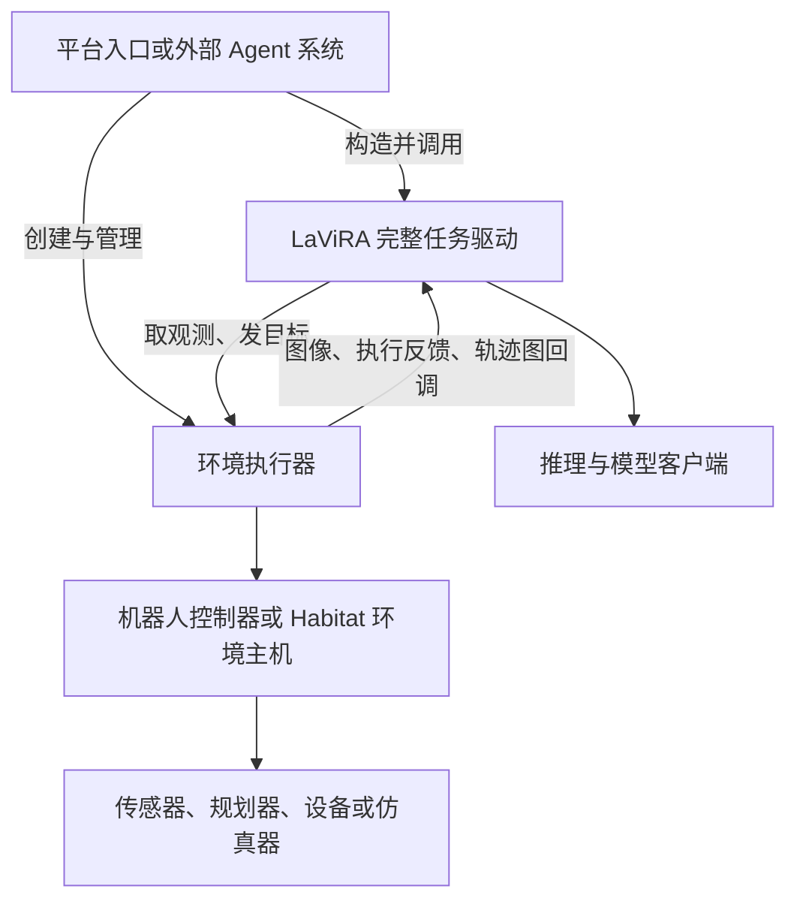

# LaViRA 重构与源码导读

这组文档带你沿着“收到导航任务、观察环境、调用模型、发出动作、返回结果”的顺序阅读代码。读完后，应能判断一段逻辑属于 LaViRA 算法、环境执行能力，还是把两者接起来的启动入口，并能找到对应实现。

源码基线为 `31873f9`。本次文档工作只增加阅读材料，不改变算法、控制或接口行为。第一阶段已经接入 Habitat、Go1、G1、Cobot 的 VLN、ObjectNav、EQA；AirSim 和自研无人机保留原实现，不属于已统一的范围。

## 从哪里开始

| 阅读顺序 | 这一篇回答什么 | 主要代码 |
| --- | --- | --- |
| [01 重构了什么](01-refactor-map.md) | 哪些重复实现被收拢，哪些职责迁出，哪些差异刻意保留 | Git 提交与迁移前后文件对照 |
| [02 一次任务如何运行](02-task-lifecycle.md) | 指令如何经过 LA、VA、执行和记忆更新，三类任务怎样结束 | `lavira/agent.py`、推理模块、客户端 |
| [03 接口与责任边界](03-runtime-contract.md) | 两侧究竟交换什么，单位、坐标、状态和生命周期由谁负责 | `lavira/runtime.py`、`navigation_runtime/` |
| [04 Go1 与 G1](04-go1-g1.md) | 相同执行器怎样保留两种机器人策略，轨迹图如何回到算法 | 任务入口、相机执行器、机器人控制器 |
| [05 Cobot](05-cobot.md) | 机械臂采图、复位、像素导航与 TODO 如何配合 | Cobot 入口、云台执行器与控制器 |
| [06 Habitat](06-habitat.md) | 地图执行、历史回溯、停止确认和评测如何分工 | `MappedTask`、地图执行器、环境主机 |
| [07 接入通用具身 Agent](07-agent-integration.md) | 如何调用完整任务、替换算法，以后迁出环境代码要移动哪些部分 | 组装示例与迁移边界 |
| [08 验证与剩余限制](08-verification-and-limits.md) | 测试具体证明了什么，哪些旧问题和真实环境验证仍未完成 | 对照测试、边界测试与验收记录 |

第一次阅读建议按 01 → 02 → 03，再选择关心的平台。若主要关心未来接入自己的 Agent 系统，可以先读 03 和 07，再回到平台篇核对具体能力。

## 先认识三个位置

用户说“走到椅子旁边”时，平台入口先准备模型配置与机器人或仿真环境。LaViRA 接收任务，通过观测选择方向和目标；执行层把目标变成平台能完成的运动。相机采集、地图更新和电机命令仍需各平台自己的实现。

图中的双向数据往来不代表双向代码依赖。核心使用 `navigation_runtime` 的数据类型；执行器没有导入 LaViRA。只有组装入口需要同时认识两侧。共享核心也仍有 Go1、G1、Cobot、Habitat 四种兼容策略，它们保留原有 prompt、视角和停止规则。

## 阅读时如何核对

每篇先解释一个具体过程，再给必要的代码片段、字段或方法对照。源码链接指向当前仓库，并带有 `#L` 行号；后续代码变动导致行号漂移时，可用旁边的函数名继续定位。

文中的三类内容分开标明：当前入口实际调用的行为；已存在但受配置限制或未启用的分支；未来通用 Agent 可以采用的接入示例。示例不是已经部署到外部系统的实现。

理解“完成”也需要看证据：LaViRA 结束任务，不等于环境评测成功；轨迹执行函数返回，不等于真机抵达；设置取消信号，不等于设备已制动。本次验收是离线验证，具体范围在第 08 篇。

## 与已有文档的关系

- [统一方案正文](../../unified-lavira-agent.md)：目标、范围和原方案修订。
- [核心设计](../lavira-core-design.md)：已经约定的责任边界与保留行为。
- [使用说明](../lavira-usage.md)：安装和完整调用示例。
- [迁移与验收记录](../lavira-migration.md)：提交安排、检查结果和已确认的取舍。

本导读补充这些文档没有逐步展开的源码阅读过程。查运行环境、数据集或硬件部署时，仍需使用各平台 README。
