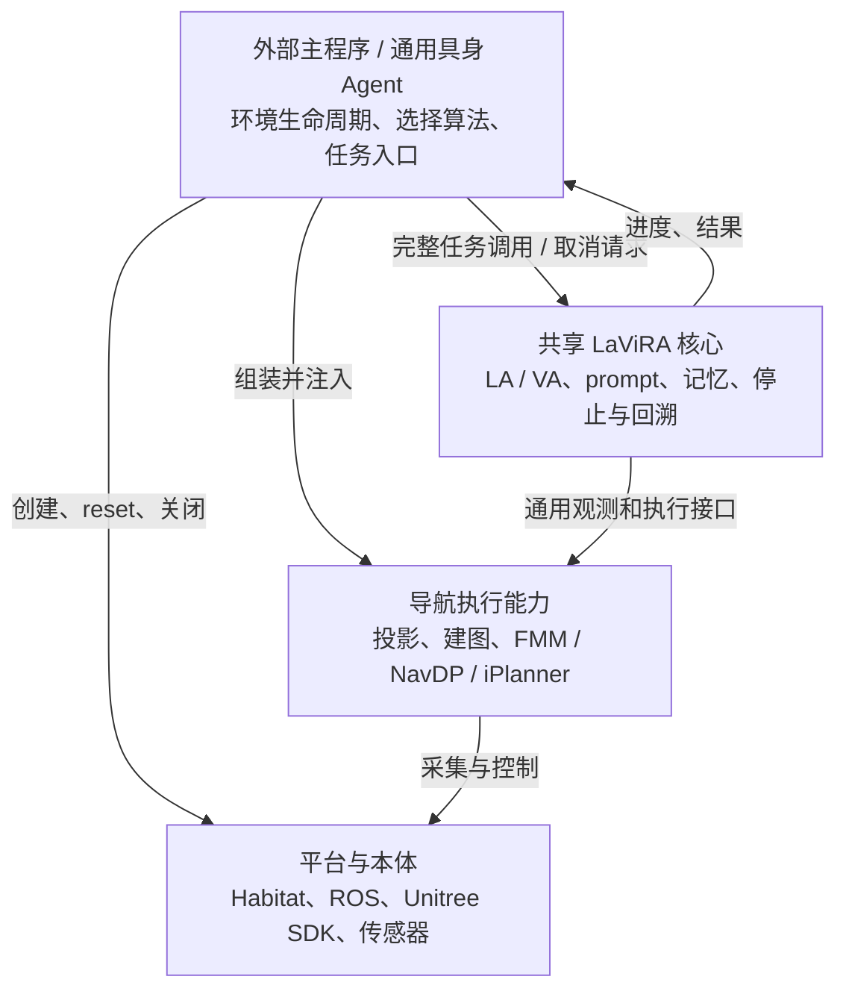
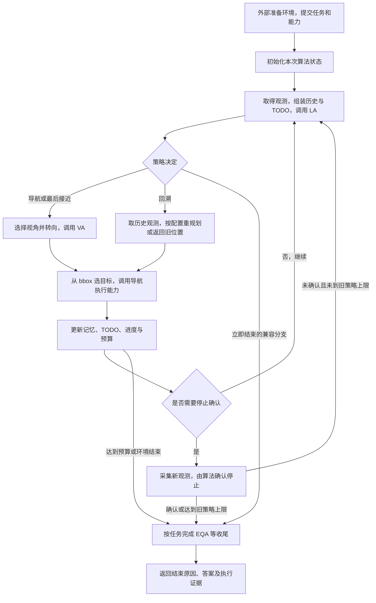

# 一套算法核心，多种环境与本体

第一阶段覆盖 Habitat、Unitree Go1、Unitree G1、Cobot Magic 的 VLN、ObjectNav、EQA。 外部系统准备环境并提供观测、执行能力，LaViRA 完成一次导航任务；以后可以迁出环境代码，也可以替换导航算法。

第一阶段代码已接入共享核心并通过离线检查；真实模型服务、完整仿真和真机尚未验证。原始方案保存在提交 `1c49fc2`； 代码核对基线为 `215e7ac`。详细契约见 [设计说明](docs/lavira-core-design.md)， 交付安排见 [迁移与验收说明](docs/lavira-migration.md)。

## 1. 目标与范围

消除各平台分别维护的 LaViRA 高层导航流程。共享的是推理、记忆与任务控制，平台仍使用现有传感器、运动控制、规划器和评测入口。 第一阶段先接通 VLN，再让同一核心承接 ObjectNav 和 EQA。

### 这一阶段交付

- 可独立导入的算法包，不要求安装 Habitat、ROS 或机器人 SDK。
- 完整任务调用、进度通知、取消请求和有明确语义的结果。
- 四个平台、三类任务接入共享高层循环；平台入口负责组装。
- 固定模型响应和观测下的行为对照，以及平台入口的离线接入检查。

### 已确认的限制

- 保留各端模型请求、prompt、默认参数和策略差异。
- 当前服务器没有机器人；测试不能证明真机到达或物理停止。
- AirSim、自研无人机留待后续；不合并现有运行环境。
- 行为修正、新增依赖交用户决定；只做本地提交。

## 2. 原方案需要修正的地方

| 原表述或遗漏 | 代码事实与修订 |
| --- | --- |
| 所有端都能直接套用“四方向、LA → VA → 执行” | Go1 用三方向，G1/Habitat 用四方向，Cobot 包括斜向的七个有效视角；停止、回溯和任务收尾必须成为共享循环的分支。 |
| LA 表示停止，就确认并结束 | Go1/G1 的停止可能包含最后一次 bbox 接近；Habitat 接近后重新采集全景、二次确认，并保留失败累计三次强制停止。Cobot 的 LA STOP 则直接结束该导航循环。 |
| 回溯就是去旧 waypoint | Habitat 可在历史全景上重新 LA/VA，利用当时的深度和位姿生成新目标；另一配置才直接返回旧位置。 |
| Adapter 接收 StrategicDecision/TacticalDecision，负责 confirm_stop | 这会让环境依赖 LaViRA。停止确认和决策解析属于算法；环境接收转角、像素目标及观测引用等通用执行输入。 |
| Agent 调用 adapter.reset_episode | 用户已选择外部管理环境生命周期。主程序负责创建、reset、关闭环境；Agent 只重置本次任务的内部状态。 |
| 统一 client 就统一请求方式，统一 prompt 以 Habitat 为底本 | 机器人客户端三份完全相同，可先合并；Habitat 的返回格式、请求参数、重试和失败返回不同。保留兼容策略，不能借抽包替换请求或 prompt。 |
| 历史轨迹图只是可视化 | Go1/G1 会把这些图送入 LA。历史图的生成、取样和次序属于行为对照范围。 |
| 空中平台 VA 都输出距离/高度 | AirSim 的实际入口有距离/高度输出；自研无人机实际流程也使用 bbox，且在转向前调用 VA。暂缓接入的理由是范围和执行差异，不能用错误的输出分类解释。 |
| 规划器、建图必须属于具体本体 | 应与算法决策分开，但 FMM/NavDP/iPlanner 可作为可复用导航执行服务。第一阶段保持现有实现，不强制复制到每个驱动。 |

## 3. 必须保留的平台差异

| 项目 | Habitat | Go1 | G1 | Cobot |
| --- | --- | --- | --- | --- |
| 视角 | 12 次实际左转采集，整理为四方向 | 前、右、左 | 前、右、后、左 | 8 个槽位，后方为空，7 个有效方向 |
| TODO 初始化 | 结构化生成、增量更新；任务 prompt 不同 | 占位文本，首次 LA 更新 | 单独请求初始 TODO | 空文本，LA 更新；到达后完成首个未完成项 |
| VA 输入与定位 | RGB 与深度；楼梯影响像素锚点及执行 | RGB；bbox 高度约 75% 处取深度 | RGB；bbox 底边中心取深度 | RGB；bbox 底边中心，缺失时用图像中心 |
| 历史与回溯 | 全景、历史帧、位姿和 waypoint；可回溯重规划 | iPlanner 历史图参与 LA | iPlanner 历史图参与 LA | 文字目标历史；无同等回溯流程 |
| 停止 | 最后接近、全景二次确认、失败计数 | 有 bbox 时最后接近，再结束 | 有 bbox 时最后接近，再结束 | LA STOP 或 TODO 全部完成 |
| 局部执行 | 地图、FMM/NavDP、逐步推进仿真 | iPlanner、轨迹留出末端 1.5m、UDP 控制 | iPlanner、配置的安全距离、SDK 控制 | 像素投影、iPlanner、ROS 动态跟踪 |
| EQA 收尾 | 停止路径调用问答，评测器记录答案与结束 | 继承导航后采图回答 | 继承导航后采图回答 | 继承导航后使用相机图回答 |

“共享核心”不等于把这些差异改成一种默认策略。兼容配置保存数据和有限分支；不得为每个平台再复制一个完整任务循环。

## 4. 职责与依赖方向

依赖从具体组装指向通用契约。LaViRA 不导入平台；环境与执行代码不接收 LA/VA 决策类型。

先在仓库根目录建立 `lavira/` 包，旧目录保留入口和环境代码。 通用执行数据与适配器在 `navigation_runtime/`，可随环境代码迁出；只声明正在使用的接口，不提前引入插件注册、RPC 或任务队列。 算法专用配置保留在核心；相机、控制和规划参数仍由外部提供。

## 5. 一次导航任务怎样运行

取消在已有任务检查点处理。此图展示共享流程及必要分支，不表示各平台都执行停止确认或回溯。

只有一个高层任务驱动器。导航执行服务仍可有高频控制循环，模型重试仍可有自己的循环；这些不是重复的 LaViRA pipeline。 VLN 和 ObjectNav 使用任务对应的提示与结束规则，EQA 增加问答收尾，不能另起一套高层导航循环。

## 6. 观测、执行与结果契约

| 边界 | 必须说明的语义 |
| --- | --- |
| 观测 | 图像内容及通道约定、深度单位、图像尺寸、视角、采集时位姿/相机参数。历史图必须与历史深度和位姿绑定；不能拿新深度解释旧 bbox。 |
| 转向和像素目标 | 角度单位与正方向、像素坐标所属图像、越界处理和锚点策略。归一化 bbox 的原有识别规则保留在兼容解析中，不让驱动猜测模型输出。 |
| 位置目标 | 目标与参考坐标系一起传递；Habitat 地图格、机器人局部米制目标、世界位置不能混为裸二元组。 |
| 执行反馈 | 区分动作返回、确认到达、超时、失败、状态未知；允许旧执行器没有到达证据。不得把返回 None 自动解释为到达。 |
| 任务结果 | 分别表达算法的结束原因、问答答案和环境成功指标；模型说 STOP 不等于导航成功。 |
| 取消 | 请求取消、任务循环已响应、底层停止已确认是不同事实。第一阶段保留现有阻塞段与收尾规则，不能承诺即时制动。 |
| 生命周期 | 外部创建、reset 和关闭环境；每次完整任务调用持有独立算法状态。入口不应暗中复用上个任务的记忆。 |

部分旧执行器会在动作执行时读取实时深度，Habitat 的 CPU 历史位姿也可能保留共享引用。 本次保留这些兼容语义；绑定采集帧或冻结位姿会改变目标和轨迹，需要另行决定。详见设计说明中的待决问题。

## 7. Habitat 的迁移边界

从 [VLMReasoningAgent](sim-code/habitat/vlnce_baselines/agent.py) 提取请求、解析、TODO 与记忆， 从 [评测器 rollout](sim-code/habitat/vlnce_baselines/ZS_Evaluator_mp.py) 分出高层任务推进。 环境 reset、数据集、地图、底层动作与指标仍归外部；采集全景产生的 12 次动作及其预算也必须记录。 [HabitatEnvironment](sim-code/habitat/vlnce_baselines/habitat_environment.py) 提供独立环境能力，旧评测器只组装它和 LaViRA。

- 保留“停止信号 → 转向/VA → 最后接近 → 新全景二次确认”的顺序。
- 回溯重规划使用旧视图、深度和位姿；重访记忆仍保存来源关系。
- 楼梯信息转为明确的执行提示；执行服务不读取 `agent.stair` 等算法内部对象。
- 历史图既用于推理也用于日志。用外部提供的记录回调承接可视化，不让核心导入 Habitat logger 或 visualizer。
- EQA 答案交给评测器；保留该任务与普通 STOP 不同的结束处理。

## 8. 三台机器人的迁移边界

三个 `ai_client/vision_client.py` 可直接去重。 `robot/navigation_api.py` 实际包含 LaViRA prompt 和解析，应迁入核心； `tasks/vln.py` 的高层流程并入共享驱动器，原任务类保留参数转换和兼容入口。

- **Go1：**保留三视角、转向后再采图的顺序、VA 锚点、轨迹末端安全距离、历史图与停止后的等待。
- **G1：**保留独立初始 TODO 请求、后方视角、bbox 归一化识别、配置的安全距离和现有控制路径。
- **Cobot：**保留全景时的机械臂复位线程、七方向、LA 直接停止、到达后更新 TODO。VLN/ObjectNav 的重复循环合并。
- **三端 EQA：**问答与导航共用任务状态和结果接口；现有取消后仍可能进入问答的问题先列出，不暗改。

相机、机械臂、iPlanner 调用及速度控制留在可迁出的执行代码中。 一个最小替代算法的离线检查应能使用这些通用能力，不导入 LaViRA 的 prompt 或决策类型。

## 9. 验收与待决定的问题

第一阶段以离线证据验收：保存固定响应，比较原入口与新核心的请求内容、图像顺序、决策、动作顺序和结束原因； 检查四个平台 × 三类任务的接入。模型服务、真实仿真和真机分别记录，未运行的层级明确标为未验证。

| 检查 | 能证明的内容 |
| --- | --- |
| 请求与轨迹回放 | 给定输入下 prompt、请求参数、策略分支、动作次序未漂移；不证明模型在线输出相同。 |
| 导入与依赖检查 | 核心不依赖 Habitat、ROS、SDK；环境契约不依赖 LA/VA 类型。 |
| 任务与入口测试 | VLN/ObjectNav/EQA 实际接入核心；覆盖停止、回溯、空观测、超预算和已有取消检查点。 |
| 硬件部署回归 | 需要未来在相应机器人和运行环境上完成；当前不作为已经取得的证据。 |

已发现但本次不自行修正：解析失败后的默认移动、bbox 缩放歧义、旧执行器到达证据不足、取消后仍问答、停止旧任务等待不足。 逐项说明影响，待用户决定后用独立提交处理。

## 10. 提交和实施顺序

1. 忽略本地索引、缓存和环境文件：已提交 `ab901b1`。
2. 保存原始 HTML：已提交 `1c49fc2`。
3. 本页修订与补充设计、迁移说明：已单独提交 `dccbbe6`，先于代码修改。
4. 先共享客户端、保留两类请求语义，并建立离线基线。
5. 建立通用观测/执行契约和共享任务驱动，逐端接入 VLN；同时保留原入口。
6. 接入 ObjectNav、EQA，删除重复高层循环，完成依赖方向和行为回归检查。
7. 每次本地提交只对应一个明确目的，英文标题、中文编号正文；不 push。

本文由 `unified-lavira-agent.html` 转换，后续方案讨论以本 Markdown 为主；HTML 保留作参考。原始版本可通过 Git 提交 `1c49fc2` 查看。
